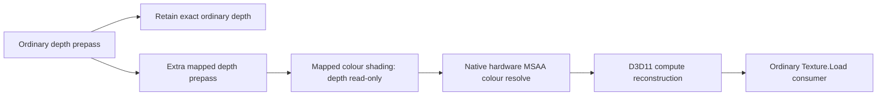

# Joined mapped-prepass foveation experiment

9 November 2026. Follow-up to the [prepass reuse compatibility gate](dxmt-prepass-reuse-foveation.md).

**A second mapped depth prepass retains a net GPU saving in the complete restricted D3D11 fixture.** At a 0.5 peripheral axis rate, joined GPU time falls about 44–45% at 2× MSAA and 43% at 4×. The interval includes the retained ordinary depth prepass, extra mapped depth prepass, colour shading, native hardware MSAA resolve, colour reconstruction and a conventional texture consumer. These are synthetic mono results, not EXD or headset frame-rate measurements.

No automatic profile or game pass was enabled. The existing private DXMT source and patches 0001–0011 are unchanged by this stage; only the test fixture/helper and analysis tools grew.

The [EXD replay/stencil audit](dxmt-exd-replay-audit.md) now confirms masked
prepass coverage and a later consumer of main-pass stencil bits. Its HDR/stencil
fixture exposes additional work absent from this timing result.

## Joined pipeline



Baseline runs an ordinary depth prepass, ordinary depth-read-only colour shading, the same hardware resolve and the same final consumer. It does **not** pay for an identity reconstruction kernel. The foveated path retains the ordinary depth allocation and adds its own mapped depth prepass before mapped colour shading. Both depth prepasses use the same restricted geometry/VS and no pixel shader.

MSAA is already native: DXMT creates actual Metal multisample textures for the D3D11 resources and `ResolveSubresource` uses the Metal hardware colour-resolve path. The test resolves **before** reconstructing, so it never reconstructs a full-resolution MSAA colour texture just to resolve it afterwards. It retains source samples; it does not pretend a resolved image repairs mapped source coordinates.

The [new test header](../tests/windows/dxmt_joined_prepass_probe.h) prepares shaders, vertex buffers, states, LUTs and targets once. It uses the existing scene and map infrastructure. A new CPU-only helper operation exports the same clamped logical-to-physical sample-centre coordinates used by the earlier native resolve-first helper. The D3D11 compute shader applies bilinear reconstruction with those coordinates; an independent native implementation verifies the result outside timing. Existing helper operation numbers and fields are preserved, with the coordinate pointer appended to the private fixture parameter structure. Rebuild both helper halves and the executable together.

## Timing protocol

M5, macOS 27.0.1, Metal validation enabled, logical 1024². D3D11 timestamp queries bracket each **whole sequence**, with no timestamps, CPU readbacks, native helper calls or CPU completion waits between its start and end. All GPU work stays on the normal D3D11 queue. Frequency/disjoint status and timestamp ordering are checked. Query/encoder barrier overhead remains part of the method; this is not an uninstrumented game frame.

Each process records 65 rounds of baseline/foveated pairs, alternating their order each round. The first 24 rounds are warm-up; medians use the remaining 41. Repeated trials include the reversed starting order. Rates 0.5 and 0.75 have three trials each per sample count; full-rate controls have two. There are 16 final cases. Earlier three-warm-up exploratory runs varied during clock warm-up and are superseded by these runs.

Compilation, texture/buffer/PSO creation, coordinate construction, correctness readback and independent native reference measurements are excluded. Timed recording calls can block under DXMT queue backpressure. Their CPU medians are archived but must not be interpreted as pure CPU execution cost or proof of reduced CPU work.

Summary/audit logging is disabled for the primary performance matrix. A separate audit run confirms **156 actually mapped D3D render passes**: the mapped one-pass reference plus the mapped depth/colour passes in the correctness and timing sequences. It is not included in the performance ranges below.

## Results

Ranges span the final process trials; each value is a median of whole GPU sequences, not a sum of component medians.

| MSAA | Peripheral axis rate | Baseline GPU ms | Foveated GPU ms | Net reduction |
|---|---|---:|---:|---:|
| 2× | 0.5 | 1.0174–1.0181 | 0.5623–0.5632 | 44.6–44.8% |
| 2× | 0.75 | 1.0176–1.0180 | 0.8023–0.8034 | 21.0–21.2% |
| 4× | 0.5 | 1.0386–1.0389 | 0.5906–0.5908 | 43.1% |
| 4× | 0.75 | 1.0386–1.0392 | 0.8366–0.8369 | 19.4–19.5% |
| 2× | 1.0 control | 1.0180–1.0185 | 1.0816–1.0818 | **6.2% slower** |
| 4× | 1.0 control | 1.0387–1.0399 | 1.1199–1.1221 | **7.8–7.9% slower** |

Active physical regions are 696² at rate 0.5 and 864² at rate 0.75. Allocations remain logical-sized. The slower full-rate controls expose the cost of the additional prepass/reconstruction when no pixels are saved.

This scene has 22 triangles, a trivial vertex shader and a synthetic 128-sine fragment workload. The extra depth prepass adds a third geometry traversal to the baseline's two. EXD's observed main pass has hundreds of thousands of vertices and multiple shader/material/instance states; replaying its geometry may be materially more expensive. Do not extrapolate the percentages into EXD GPU time or FPS.

## Correctness and quality

Every final case checks before and after timing:

- Baseline output equals the independent ordinary one-pass resolved reference bit for bit.
- Every retained ordinary MSAA depth sample matches that reference exactly.
- Mapped depth and colour match the independent mapped one-pass scene within the fixture's 3/255 colour tolerance; depth is exact. This isolates the copied-depth visibility failure found in the previous stage: it is absent here.
- Full-rate reconstructed RGB has zero error; the full-rate centre ROI has zero out-of-tolerance pixels at reduced rates.
- The D3D11 reconstructed image matches the independent native resolve-first reconstruction within 1/255 per RGB channel.
- The final consumer uses ordinary `Texture.Load`, after reconstruction.

Reduced-rate colour remains approximate:

| MSAA | Rate | Final pixels differing >3/255 | Percent | Mean absolute RGB error, 8-bit levels |
|---|---|---:|---:|---:|
| 2× | 0.5 | 25,250 / 1,048,576 | 2.41% | 0.455 |
| 2× | 0.75 | 22,869 / 1,048,576 | 2.18% | 0.308 |
| 4× | 0.5 | 30,247 / 1,048,576 | 2.88% | 0.424 |
| 4× | 0.75 | 22,352 / 1,048,576 | 2.13% | 0.270 |

These are final resolved pixel comparisons, unlike the previous gate's physical-layout per-sample error counts. They measure foveation image loss, not depth-prepass incompatibility. Image inspection still shows peripheral thin-strip and edge changes. Lower peripheral resolution is not established as acceptable for moving stereo VR, text/UI, temporal effects or eye movements.

[Ordinary reference](results/dxmt-joined-prepass-20261109/images/2x-baseline.png), [rate 0.5](results/dxmt-joined-prepass-20261109/images/2x-rate050.png), [rate 0.75](results/dxmt-joined-prepass-20261109/images/2x-rate075.png), [rate 0.5 difference](results/dxmt-joined-prepass-20261109/images/2x-rate050-difference.png). These are logical-space final images; orange masks mark differences above 3/255.

## Memory and remaining barriers

The fixture keeps ordinary and mapped RGBA8/D32Float MSAA pairs, two single-sample resolve targets, two consumer outputs and one reconstructed target. Their nominal texel payload totals 52 MiB at 2× or 84 MiB at 4×, plus LUTs, geometry, queries and runtime overhead. This is a resource inventory, not measured Metal allocation size or resident-memory use. In particular, the hidden mapped colour/depth pair alone retains 16/32 MiB of logical-sized payload. No texture-memory saving is claimed from the smaller active region.

The result establishes that a restricted extra-prepass design can produce a joined net GPU benefit. It does **not** implement transparent replay in DXMT. Remaining gates include:

1. **Actual prepass semantics.** Identify EXD's relevant VS/PS behaviour, alpha testing, custom depth/coverage, deformation, geometry/indirect/query/UAV side effects and whether each draw can be duplicated safely. Nulling an arbitrary game pixel shader is unsafe.
2. **Stencil and formats.** EXD's main pass uses combined depth/stencil and HDR colour. The earlier trace only recorded stencil enable/write-mask snapshots; actual front/back operations and references still need auditing. This D32Float fixture does not preserve EXD's potential main-pass stencil writes.
3. **Resource representations.** The mapped MSAA source remains mapped after producing an ordinary resolved output. Later render loads, shader reads, copies, aliases, exports or resolves require representation tracking/materialisation or a proven overwrite boundary. This test's final ordinary output is not a blanket D3D11 source-compatibility claim.
4. **Stereo and temporal work.** Eye/subrect selection, screen-space effects, UI exclusion, temporal stability and gaze are untested. No MetalFX/DLSS work occurs inside these sequences.

The next bounded step is an EXD shader/stencil audit for a clearly identified pass, then a representative HDR/stencil fixture before attempting an optional game profile. This measured result justifies investigating that path; it does not justify enabling replay across arbitrary passes.

## Reproduction and regressions

```sh
export DXMT_SOURCE_DIR="$PWD/build-in-process/dxmt-foveation-source"
export MWXR_WINE_SDK=/Users/nickkennedy/Code/wine-crossover/runtime
export MWXR_WINE_SOURCE=/Users/nickkennedy/Code/wine-crossover/sources/wine
export MWXR_IN_PROCESS_WINE="$PWD/build-in-process/exd-ngx/wine"
scripts/build-dxmt-depth-foveation-probe.zsh
scripts/test-dxmt-joined-prepass.zsh
# Individual case: samples, size, mode, rate, optional reversed starting order.
scripts/run-dxmt-depth-foveation-probe.zsh 2 1024 --joined-prepass 0.5 --reverse
python3 -m unittest discover -s tests/macos -p '*joined_prepass*.py'
```

[Curated trial rows, summaries, images, audit and hashes](results/dxmt-joined-prepass-20261109/summary.json) preserve the complete timings. Analyser tests reject missing/duplicate timing rows, invalid warm-up selection, incorrect controls and inconsistent reported medians. Existing prepass-reuse, resolve-first and depth/MSAA regressions were rerun against the rebuilt paired helper; results are archived alongside the new suite. EXD, Steam and installed runtime settings were not changed.
