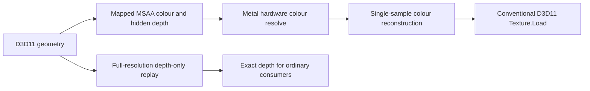

# DXMT resolve-first foveation and peripheral-rate sweep

2026-11-09. Resolving the mapped MSAA colour **before** reconstruction removes the
need to build a full-resolution MSAA colour texture for this consumption boundary.
The new explicit diagnostic works at 2×/4× MSAA, keeps exact depth separately, and
passes ordinary D3D11 `Texture.Load` and full-rate identity controls.

A 0.5 peripheral rate gives stable synthetic GPU component totals of **0.642–0.695
ms**, against **1.009–1.062 ms** baseline, across normal/reversed scene order. That
is about 35–36% lower for the tested workload. This is not a joined game-frame
measurement, automatic game support or an EXD/headset FPS result.

There is a concrete transparency barrier: **the original MSAA source still has
mapped coordinates**. Producing an ordinary resolved destination does not repair
that source for later D3D11 reads. The fixture demonstrates this explicitly;
no automatic profile was expanded or enabled.

The [prepass-reuse follow-up](dxmt-prepass-reuse-foveation.md) now tests whether
ordinary depth can seed mapped shading without rerasterisation. The tested copies
fail depth visibility, while a matching mapped prepass passes its controls.

## Implementation

The existing depth/MSAA fixture was extended rather than adding another map or
gaze subsystem. No DXMT production-source change was needed beyond the preceding
optional patch 0008. The native/PE helper ABI grew and both halves are rebuilt
together by the existing build script.

The tested sequence is:



The resolve and reconstruction run in **one native GPU command buffer**, with
normal ordered encoder dependencies. The resolve uses
`StoreAndMultisampleResolve`, preserving the original physical sample contents.
Reconstruction reuses the exact axis mapping and clamps to the active region to
avoid sampling unused allocation edges. A compute kernel writes ordinary RGBA8
colour, then a standard D3D11 shader reads every pixel with `Texture.Load`.

The depth-only replay uses the same restricted no-discard/no-custom-depth shader
fixture as the preceding experiment. Every full-resolution MSAA depth sample is
checked before/after replay and again after native processing. None changes.
This remains a test-only synchronous helper, not an asynchronous replay feature
inside DXMT. It does not establish replay safety for EXD's actual shaders.

Peripheral rates 0.25, 0.5, 0.75 and 1.0 are tested along each axis. The centre two
of eight cells stay at 1.0. Requested rates are not assumed to determine physical
sizes exactly: Metal reports 528², 696², 864² and 1024² active regions for 1024²
logical targets. Allocations remain logical-sized, so no allocation-memory saving
is claimed.

## Timing protocol and controls

M5, macOS 27.0.1 (26A434), Metal validation enabled. Each D3D scene/replay uses
24 separately timestamp-bounded operations, discards three warmups and reports
median21. Native resolve-only, unwarp-only and joined resolve+unwarp phases rotate
order across 24 rounds, with three warmup rounds discarded per phase. Native GPU
completion and timestamp validity are checked.

The fair baseline uses the ordinary native resolve measured by that same native
timing method. Ordinary D3D `ResolveSubresource` supplies the correctness reference;
its separate D3D-query duration is retained as a diagnostic, not substituted into
the primary timing comparison. Timestamp/barrier and command-buffer overhead can
be material in these small operations.

Two scene orders are tested: ordinary then mapped, and mapped then ordinary.
At the primary 1024² size, full-rate mapped/ordinary scene times match closely;
with no pixel reduction, replay+reconstruction correctly adds cost. An exploratory
512² full-rate run showed a large scene-order/timing imbalance, so it is excluded
from the rate-sweep performance conclusions. No cause is asserted from that
single small-target observation.

All 16 packaged cases pass:

- Unmapped native resolve/reconstruction equals ordinary D3D resolve bit-for-bit.
- Rate 1.0 gives zero colour differences and zero source-layout differences.
- The full-rate central region gives zero pixels outside 3/255 RGB tolerance.
- Full-resolution depth is bit-identical before/after replay and processing.
- Exactly 24 mapped scene render encoders appear per trace.
- Physical MSAA source contents are unchanged by resolve/reconstruction.
- For rates below 1.0, an ordinary logical-index read of that source demonstrates
  the expected unresolved coordinate-layout mismatch; this is not called a
  compatibility pass.

Shader compilation, resource/LUT construction, imports, CPU waits, readback and
file output are excluded. Only the colour resolve+unwarp is measured as a joined
sequence. Scene and exact-depth replay remain separate component medians.
**The total is a sum of component medians, not whole-frame GPU time.** CPU overhead,
MetalFX, actual EXD geometry, stereo, gaze and memory residency remain unmeasured.

## Rate, performance and quality

1024² fixture, both scene orders; baseline totals are about 1.01 ms for 2× and
1.06 ms for 4× MSAA. The shader has a synthetic 128-sine fragment workload and a
trivial vertex shader, so replay is unusually cheap compared with a real game.

| Peripheral axis rate | Active dimensions | 2× component total ms | 4× component total ms |
| --- | --- | ---: | ---: |
| 0.25 | 528² | 0.447–0.691 | 0.506–0.671 |
| 0.5 | 696² | **0.642–0.644** | **0.693–0.695** |
| 0.75 | 864² | 0.876–0.886 | 0.922–0.930 |
| 1.0 control | 1024² | 1.135–1.141 | 1.186–1.197 |

The aggressive 0.25 case is order-sensitive, even though its output differences
are deterministic. Do not use only its fastest result. The gentler 0.5/0.75 cases
are much more consistent across these two orders. Two orders do not establish a
controlled performance distribution under a sustained VR workload.

Joined colour resolve+reconstruction is approximately 0.086 ms at 2× and 0.138 ms
at 4×. The single-sample unwarp alone is approximately 0.021 ms. These numbers
are separate medians; do not add phase medians to explain the measured joined
value. Unlike the previous per-sample MSAA reconstruction test, this specific
boundary retains potential savings at 4× in both orders.

Output quality against ordinary **pre-overlay resolved scene colour**:

| Rate | 2× pixels differing >3/255 | 4× pixels differing >3/255 | 2× mean absolute RGB error, 8-bit levels |
| --- | ---: | ---: | ---: |
| 0.25 | 52,413 (5.00%) | 53,017 (5.06%) | 0.884 |
| 0.5 | 22,861 (2.18%) | 27,509 (2.62%) | 0.402 |
| 0.75 | 21,326 (2.03%) | 20,743 (1.98%) | 0.279 |
| 1.0 | 0 | 0 | 0 |

These counts are not directly comparable with the previous report's images after
a depth-tested overlay. Here the reference is the ordinary scene immediately
after resolve, before any overlay hides errors.

A simple pink-strip classification in a fixed peripheral ROI reports 3,380,
2,567 and 977 missing classified pixels at rates 0.25, 0.5 and 0.75 (2×). This is
a synthetic thin-feature indicator, not a geometry-coverage or perceptual metric.
Native-size/3× crop inspection confirms that 0.5 can lose the thinnest strips;
0.75 is visibly closer, though still blurred. Neither is established as acceptable
in a moving stereo headset. Full-rate centre output remains correct.

[Baseline crop](results/dxmt-resolve-first-20261109/images/baseline-thin-crop.png),
[0.5 crop](results/dxmt-resolve-first-20261109/images/rate050-thin-crop.png),
[0.75 crop](results/dxmt-resolve-first-20261109/images/rate075-thin-crop.png).
Crops use nearest-neighbour 3× enlargement so pixel structure is visible.
[Full images and difference masks](results/dxmt-resolve-first-20261109/README.md)
retain native resolution; orange marks >3/255 RGB differences.

## Why this cannot yet become a transparent resolve hook

A conventional [D3D11 resolve](https://learn.microsoft.com/en-us/windows/win32/api/d3d11/nf-d3d11-id3d11devicecontext-resolvesubresource)
produces a single-sample destination from the multisample source. It does not
establish that the application will never use the source again. `Texture2DMS.Load`,
a later render pass loading old colour, another resolve or a resource copy can
still observe it.

The fixture now reads the mapped MSAA source both before and after native work.
Its physical contents are preserved exactly, but a logical-index comparison with
ordinary rendering fails. For rate 0.5 at 2×, 1,995,351/2,097,152 source colour
samples differ beyond tolerance; mapped depth also has the wrong representation.
The correct resolved destination does not fix these source semantics. Exact
full-resolution depth is a separate retained resource in the proposed design.

Code-level integration points in the current private fork:

- `d3d11_context_impl.cpp::ResolveSubresource` invalidates the current render pass,
  builds format-compatible views and queues `enc.resolveTexture`. At that point
  a resolve boundary is visible, but later source uses remain possible.
- `dxmt_context.cpp::ArgumentEncodingContext::resolveTexture` records an ordinary
  source read/destination write through `access`; it has no pending mapped-source
  representation or per-consumer materialization contract.
- The automatic prototype redirects/materializes at `endPass` and deliberately
  supports only single-sample colour. Moving materialization to a future resolve
  without new source-state tracking would weaken its correctness guarantees.

A bounded automatic extension therefore needs either a proven discard/overwrite
boundary or representation state attached to the allocation generation, shared
by all aliases/views. Every incompatible read, load, copy, export and subsequent
resolve must materialize correctly; a full clear can discard old contents.
Renames, command lists, partial writes and native exports need explicit handling.
A source that unexpectedly needs full MSAA reconstruction must pay that cost;
the fast resolve-only path cannot be assumed universal.

**Do not simply enable depth/MSAA in the existing automatic profile.** The next
implementation gate is a narrow one-resource state-tracking prototype with an
ordinary post-resolve MSAA read as a required regression. It must preserve
fallback and measure one queued scene/replay/resolve/materialization sequence.
Use known depth-invariant shader fingerprints initially. Actual EXD still needs
its HDR colour/stencil formats, multi-draw stream and stereo subrects validated;
this fixture remains RGBA8 + D32Float, one scene draw and one eye.

## Reproduce

Use the existing private runtime with patches 0001–0008 and matching PE/Unix
components. The DXMT production sources are unchanged by this follow-up. Rebuild
the diagnostic helper/executable together; do not mix older fixture binaries with
the extended helper ABI.

```sh
export DXMT_SOURCE_DIR="$PWD/build-in-process/dxmt-foveation-source"
export MWXR_WINE_SDK=/Users/nickkennedy/Code/wine-crossover/runtime
export MWXR_WINE_SOURCE=/Users/nickkennedy/Code/wine-crossover/sources/wine
export MWXR_IN_PROCESS_WINE="$PWD/build-in-process/exd-ngx/wine"
scripts/build-dxmt-depth-foveation-probe.zsh
scripts/test-dxmt-resolve-foveation.zsh
# sample count, size, mode, peripheral axis rate, optional reverse order:
scripts/run-dxmt-depth-foveation-probe.zsh 2 1024 --resolve-first 0.5 --reverse
```

The preceding per-sample depth experiment remains available without
`--resolve-first`; its legacy control and existing target/NGX regressions pass.
The normal Steam launch and installed services were not altered.

[Raw logs, summaries, fixture changes, images and hashes](results/dxmt-resolve-first-20261109/README.md).
